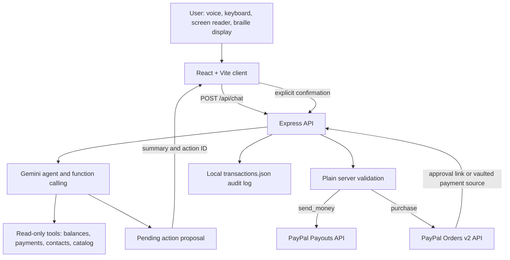

# VoicePay

VoicePay is a voice-first and text-first PayPal assistant designed for blind, deaf, and deafblind people. It helps a person check payments, send money to a saved contact, and shop online without making sight or hearing a requirement.

## Problem

Payment and shopping interfaces often depend on visual checkout flows, unlabeled controls, small targets, inaccessible product images, and audio-only feedback. A blind user may need help identifying a recipient or reviewing a purchase. A deaf user may miss spoken-only status information. A deafblind user needs both an accessible text channel and tactile or keyboard-friendly controls. These barriers make routine payments less private, less independent, and harder to verify safely.

## Solution

VoicePay combines a simple accessible React interface with an Express server. A user can speak or type a request. Gemini interprets the request using narrowly scoped tools. Payment tools only create a pending action with a spoken summary. The server moves money only after the user explicitly confirms through `POST /api/confirm`.

The demo defaults to deterministic mock PayPal data so judges can run it without credentials. PayPal Sandbox integration is available when sandbox credentials and capabilities are configured.

## Features

- Voice input with Web Speech API SpeechRecognition where the browser supports it.
- Equivalent text input and visible text for every spoken response.
- Speech synthesis with adjustable rate, persisted in local storage.
- Repeat last answer and keyboard command `R`.
- Send money to a fuzzy-matched saved contact.
- Recent payments and balances.
- Search and describe accessible products using catalog facts rather than image-only content.
- Purchase proposals with item details and explicit confirmation.
- Large Confirm and Cancel controls, spoken confirmation phrases, and expiry warnings.
- Haptic patterns for listening, confirmation, success, and errors when vibration is available.
- High contrast, semantic landmarks, focus management, reduced-motion support, and keyboard shortcuts.

## Architecture



### Repository layout

- `client/`: React and Vite accessible user interface.
- `server/src/index.js`: Express server and route registration.
- `server/src/services/agent.js`: Gemini tool declarations and orchestration.
- `server/src/services/pending.js`: server-owned pending actions and confirmation-time validation.
- `server/src/services/paypal.js`: PayPal REST client and mock adapter.
- `server/src/services/contacts.js`: JSON contact store with tolerant lookup.
- `server/src/services/catalog.js`: 20-product mock catalog behind a search/get adapter interface.
- `server/src/data/`: runtime contacts and transaction data.

## Exact setup and run instructions

### Fast mock demo

Requirements: Node.js 20 or newer and npm.

```powershell
git clone <public-repository-url>
cd voicepay
npm install
Copy-Item server/.env.example server/.env
npm run demo:reset --prefix server
$env:USE_MOCK_PAYPAL='true'
npm run dev
```

Open `http://localhost:5173`. Follow [DEMO.md](./DEMO.md) for a reliable under-three-minute presentation.

On macOS or Linux, use:

```bash
cp server/.env.example server/.env
npm run demo:reset --prefix server
USE_MOCK_PAYPAL=true npm run dev
```

The root `npm install` uses workspaces and installs the client, server, and root `concurrently` dependency. `npm run dev` starts Express on port `3001` and Vite on port `5173`; Vite proxies `/api` to Express.

### Environment variables

Copy `server/.env.example` to `server/.env`. Never commit `server/.env`.

| Variable | Required | Purpose |
|---|---:|---|
| `PORT` | No | Express port; defaults to `3001`. |
| `CLIENT_ORIGIN` | No | CORS origin; defaults to `http://localhost:5173`. |
| `USE_MOCK_PAYPAL` | No | Set `true` for the deterministic demo; set `false` for PayPal Sandbox. |
| `MAX_PAYMENT_USD` | No | Server-side maximum per payment; defaults to `100`. |
| `GEMINI_API_KEY` | For AI | Gemini API key. Keep it only in `server/.env`. |
| `GEMINI_MODEL` | No | Gemini model; defaults to `gemini-3.5-flash`. |
| `PAYPAL_BASE_URL` | For PayPal | Sandbox base URL: `https://api-m.sandbox.paypal.com`. |
| `PAYPAL_CLIENT_ID` | For PayPal | Sandbox REST app client ID. |
| `PAYPAL_CLIENT_SECRET` | For PayPal | Sandbox REST app secret. |
| `PAYPAL_VAULT_ID` | Optional | Vaulted sandbox payment token for no-redirect checkout. |
| `CONTACT_NIMAL_EMAIL` | No | Demo contact email; replace with a sandbox personal account. |
| `CONTACT_SARA_EMAIL` | No | Demo contact email; replace with a sandbox personal account. |
| `CONTACT_ALEX_EMAIL` | No | Demo contact email; replace with a sandbox personal account. |
| `TRANSACTION_LOG_PATH` | No | Optional override for the local JSON transaction log. |

### Resetting demo data

Run this before recording or presenting:

```powershell
npm run demo:reset --prefix server
```

It writes three demo contacts using the configured contact email variables and clears `server/src/data/transactions.json`. It does not touch secrets or PayPal accounts.

### Test commands

```powershell
npm test --prefix server
npm run test:paypal --prefix server
npm run lint --prefix client
npm run build --prefix client
```

## PayPal Sandbox setup

VoicePay is SANDBOX ONLY. Do not use production credentials or production endpoints.

1. Sign in to the [PayPal Developer Dashboard](https://developer.paypal.com/).
2. Create a Sandbox REST app and copy its Client ID and Secret into `server/.env`.
3. Create separate Sandbox Personal accounts for the sender/buyer and recipients/seller. Replace the three contact email variables with those Sandbox account emails.
4. Keep `PAYPAL_BASE_URL=https://api-m.sandbox.paypal.com`.
5. Request or enable Payouts capability for the REST app if Payouts calls are denied.
6. For approval-link checkout, configure return and cancel URLs in the app and use a Sandbox buyer to approve the order.
7. For no-redirect checkout, enable PayPal saved payment methods/vaulting, complete an initial save-with-purchase flow with a Sandbox buyer, subscribe to `VAULT.PAYMENT-TOKEN.CREATED`, and put the resulting vaulted token ID in `PAYPAL_VAULT_ID`.
8. Use `USE_MOCK_PAYPAL=false` only after all required values are present.

Sandbox reporting may lag behind recent activity. The local transaction log keeps confirmed and cancelled VoicePay actions available even when PayPal Transaction Search has not updated.

## How PayPal is used

All PayPal calls are made server-side with `fetch`. Access tokens are obtained with OAuth2 client credentials and cached until shortly before expiry. The service uses:

1. `POST /v1/oauth2/token`: obtain a Sandbox access token.
2. `POST /v1/payments/payouts`: send a confirmed `send_money` payout to an email.
3. `GET /v1/reporting/transactions`: retrieve recent transactions for the last 30 days.
4. `GET /v1/reporting/balances`: retrieve account balances.
5. `POST /v2/checkout/orders`: create a purchase order. With `PAYPAL_VAULT_ID`, the request uses `payment_source.card.vault_id` for the no-redirect path; without it, the response provides an approval link.
6. `POST /v2/checkout/orders/{order_id}/capture`: capture an approved or vaulted purchase.

The default mock mode returns realistic local data and never contacts PayPal.

## How AI is used

VoicePay uses Gemini through `@google/genai`, with the model configured by `GEMINI_MODEL` and defaulting to `gemini-3.5-flash`.

The model can call:

- `get_balance()`
- `get_recent_payments({ limit })`
- `list_contacts()`
- `propose_payment({ contactName, amount, note })`
- `search_products({ query, maxPrice })`
- `describe_product({ productId })`
- `propose_purchase({ productId, quantity })`
- `cancel_pending()`

The model does not receive PayPal secrets and has no money-moving tool. `propose_payment` and `propose_purchase` create pending actions only. The plain server validates amount, currency, email, product details, maximum limits, expiry, ownership, and explicit confirmation before calling PayPal. Replay, double confirmation, cancellation, expiry, tampering, cross-session access, and prompt-injection cases are covered by server tests.

## Accessibility

- Semantic `header`, `main`, `section`, and `footer` landmarks.
- Skip link, labels, accessible names, live conversation region, and visible status.
- Every assistant response is displayed as text and optionally spoken.
- Voice has an equal text-input alternative.
- Keyboard shortcuts: Space to talk, Escape to cancel, R to repeat.
- Pending action focus moves to the review panel.
- Large touch targets with a 48 pixel minimum.
- High-contrast colors and visible focus outlines.
- `prefers-reduced-motion` support.
- Product information is written in full; no feature depends on an image, sound, or color alone.
- Haptic feedback is optional and never the only status signal.
- Manual testing instructions are in [ACCESSIBILITY-MANUAL-TEST.md](./ACCESSIBILITY-MANUAL-TEST.md).

## Limitations

- Web Speech recognition and speech synthesis depend on browser and device support.
- Mock contacts and products are local demo data.
- PayPal Payouts access and vaulted payment tokens may require dashboard approval or webhooks.
- Sandbox reporting can be delayed.
- The in-memory pending-action store and server-side session binding are intended for the hackathon demo, not horizontal production deployment.
- The demo session identifier is not a full user authentication system; production use needs authenticated accounts and secure session cookies.
- Product search is currently a local adapter; it does not yet query a live merchant catalog.

## Future work

- Add authenticated user accounts, secure sessions, durable pending actions, and a production audit store.
- Replace the catalog adapter with Channel3 or another product search API.
- Add PayPal webhook handling for vaulted tokens, order approval, and payout status.
- Add multilingual speech and localized currency wording.
- Expand automated WCAG testing across mobile browsers and native assistive technologies.
- Add merchant checkout integrations and richer accessible order tracking.

## License

VoicePay is released under the MIT License. See the visible root [LICENSE](./LICENSE) file.

## Related documentation

- [DEMO.md](./DEMO.md)
- [DEVPOST-CHECKLIST.md](./DEVPOST-CHECKLIST.md)
- [ACCESSIBILITY-MANUAL-TEST.md](./ACCESSIBILITY-MANUAL-TEST.md)
