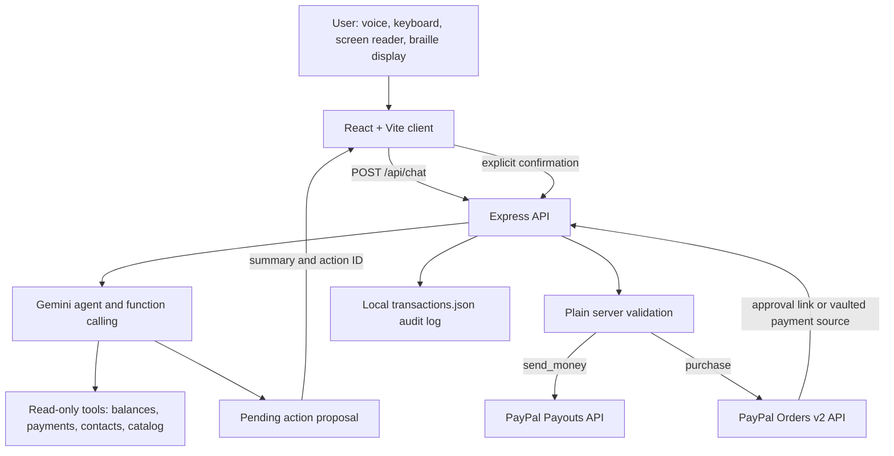

# VoicePay

VoicePay is a voice-first and text-first PayPal assistant designed for blind, deaf, and deafblind people. It helps a person check payments, send money to a saved contact, and shop online without making sight or hearing a requirement.

## Problem

Payment and shopping interfaces often depend on visual checkout flows, unlabeled controls, small targets, inaccessible product images, and audio-only feedback. A blind user may need help identifying a recipient or reviewing a purchase. A deaf user may miss spoken-only status information. A deafblind user needs both an accessible text channel and tactile or keyboard-friendly controls. These barriers make routine payments less private, less independent, and harder to verify safely.

## Solution

VoicePay combines a simple accessible React interface with an Express server. A user can speak or type a request. Gemini interprets the request using narrowly scoped tools. Payment tools only create a pending action with a spoken summary. The server moves money only after the user explicitly confirms through `POST /api/confirm`.

The demo defaults to deterministic mock PayPal data so judges can run it without credentials. PayPal Sandbox integration is available when sandbox credentials and capabilities are configured.

## Features

- Voice input with Web Speech API SpeechRecognition where the browser supports it.
- Equivalent text input and visible text for every spoken response.
- Speech synthesis with adjustable rate, persisted in local storage.
- Repeat last answer and keyboard command `R`.
- Send money to a fuzzy-matched saved contact.
- Recent payments and balances.
- Search and describe accessible products using catalog facts rather than image-only content.
- Purchase proposals with item details and explicit confirmation.
- Large Confirm and Cancel controls, spoken confirmation phrases, and expiry warnings.
- Haptic patterns for listening, confirmation, success, and errors when vibration is available.
- High contrast, semantic landmarks, focus management, reduced-motion support, and keyboard shortcuts.
- Device-based confirmation with WebAuthn platform passkeys.

## Architecture



### Repository layout

- `client/`: React and Vite accessible user interface.
- `server/src/index.js`: Express server and route registration.
- `server/src/services/agent.js`: Gemini tool declarations and orchestration.
- `server/src/services/pending.js`: server-owned pending actions and confirmation-time validation.
- `server/src/services/paypal.js`: PayPal REST client and mock adapter.
- `server/src/services/contacts.js`: JSON contact store with tolerant lookup.
- `server/src/services/catalog.js`: 20-product mock catalog behind a search/get adapter interface.
- `server/src/data/`: runtime contacts and transaction data.

## Exact setup and run instructions

### Fast mock demo

Requirements: Node.js 20 or newer and npm.

```powershell
git clone <public-repository-url>
cd voicepay
npm install
Copy-Item server/.env.example server/.env
npm run demo:reset --prefix server
$env:USE_MOCK_PAYPAL='true'
npm run dev
```

Open `http://localhost:5173`. Follow [DEMO.md](./DEMO.md) for a reliable under-three-minute presentation.

On macOS or Linux, use:

```bash
cp server/.env.example server/.env
npm run demo:reset --prefix server
USE_MOCK_PAYPAL=true npm run dev
```

The root `npm install` uses workspaces and installs the client, server, and root `concurrently` dependency. `npm run dev` starts Express on port `3001` and Vite on port `5173`; Vite proxies `/api` to Express.

### Persistence drivers

The default storage driver is the local file driver. It keeps runtime JSON files under `server/src/data/` and is the easiest option for hackathon judges:

```env
STORAGE_DRIVER=file
USE_MOCK_PAYPAL=true
```

For Render or another persistent deployment, use Firebase Cloud Firestore on the free Spark plan:

1. Create a Firebase project and enable Cloud Firestore.
2. Create a service account in **Project settings → Service accounts**.
3. Set `GOOGLE_APPLICATION_CREDENTIALS` to a local service-account JSON path, or base64-encode that JSON and set `FIREBASE_SERVICE_ACCOUNT_B64`.
4. Set `STORAGE_DRIVER=firestore` and restart the server.
5. Paste [firestore.rules](./firestore.rules) into the Firebase console. They deny all browser reads and writes; VoicePay uses only the server-side Admin SDK.
6. Verify the connection:

```powershell
npm run check-db --prefix server
```

The check writes, reads, and deletes one temporary document. Users, contacts, credentials, transactions, pending actions, WebAuthn challenges, and session history are stored in Firestore. Money is stored as integer cents internally. Expiring data is cleaned lazily; an optional Firestore TTL policy can target `expiresAt`.

Firestore usage is bounded for the Spark plan: transaction history reads are limited to 20, requests do not poll, and action/challenge reads are direct document lookups. Firebase service-account credentials remain server-only and are never sent to the client or logged.

### Environment variables

Copy `server/.env.example` to `server/.env`. Never commit `server/.env`.

| Variable | Required | Purpose |
|---|---:|---|
| `PORT` | No | Express port; defaults to `3001`. |
| `CLIENT_ORIGIN` | No | CORS origin; defaults to `http://localhost:5173`. |
| `ORIGIN` | No | Comma-separated WebAuthn origins; defaults to `http://localhost:5173`. |
| `RP_ID` | No | WebAuthn relying-party ID; `localhost` for local testing or your phone tunnel hostname. |
| `RP_NAME` | No | Name shown by the device passkey prompt; defaults to `VoicePay`. |
| `REQUIRE_DEVICE_AUTH` | No | Defaults to `true`. Set `false` only for a local DEMO ONLY bypass. |
| `CREDENTIAL_STORE_PATH` | No | Optional path for the runtime credential JSON file. |
| `STORAGE_DRIVER` | No | `file` by default for local use; set `firestore` for Cloud Firestore. |
| `FIREBASE_SERVICE_ACCOUNT_B64` | Firestore | Base64-encoded Firebase service-account JSON. Keep server-only. |
| `GOOGLE_APPLICATION_CREDENTIALS` | Firestore | Server-only path to a Firebase service-account JSON file. |
| `USE_MOCK_PAYPAL` | No | Set `true` for the deterministic demo; set `false` for PayPal Sandbox. |
| `MAX_PAYMENT_USD` | No | Server-side maximum per payment; defaults to `100`. |
| `GEMINI_API_KEY` | For AI | Gemini API key. Keep it only in `server/.env`. |
| `GEMINI_MODEL` | No | Gemini model; defaults to `gemini-3.5-flash`. |
| `PAYPAL_BASE_URL` | For PayPal | Sandbox base URL: `https://api-m.sandbox.paypal.com`. |
| `PAYPAL_CLIENT_ID` | For PayPal | Sandbox REST app client ID. |
| `PAYPAL_CLIENT_SECRET` | For PayPal | Sandbox REST app secret. |
| `PAYPAL_VAULT_ID` | Optional | Vaulted sandbox payment token for no-redirect checkout. |
| `CONTACT_NIMAL_EMAIL` | No | Demo contact email; replace with a sandbox personal account. |
| `CONTACT_SARA_EMAIL` | No | Demo contact email; replace with a sandbox personal account. |
| `CONTACT_ALEX_EMAIL` | No | Demo contact email; replace with a sandbox personal account. |
| `TRANSACTION_LOG_PATH` | No | Optional override for the local JSON transaction log. |

### Deploy to Render

VoicePay deploys as one Render Web Service. The Node server serves the built React app
and the API from the same origin, which keeps cookies and WebAuthn reliable.

1. Push the repository to GitHub and create a **Blueprint** in Render using
   [render.yaml](./render.yaml).
2. Set `APP_BASE_URL` to the final HTTPS Render URL, for example
   `https://voicepay-example.onrender.com`.
3. Set `ORIGIN` to the same URL, and set `RP_ID` to its hostname
   (`voicepay-example.onrender.com`).
4. Add the PayPal Sandbox, Gemini, and Firebase secret values requested by the
   Blueprint. Keep `REQUIRE_DEVICE_AUTH=true` and `ALLOW_DEMO_MODE=false`.
5. Deploy. Render checks `/api/health`; a sleeping free service may take up to a
   minute to wake, and the client announces this state and retries automatically.

The production-style local command is:

```bash
npm install
npm run build
NODE_ENV=production PORT=3001 npm start
```

On Windows PowerShell, set the variables before `npm start`; the scripts use
`cross-env` so the build and start commands themselves work on Windows too.
Use `STORAGE_DRIVER=file` for a disposable local simulation or
`STORAGE_DRIVER=firestore` with Firebase credentials for a persistent deployment.

The complete template is [server/.env.example](./server/.env.example). The
repository ignores `.env`, `serviceAccount*.json`, `node_modules`, and runtime
JSON files under `server/src/data/`.

### Firebase credentials on Vercel

Do not set `GOOGLE_APPLICATION_CREDENTIALS=./serviceAccount.json` on Vercel.
Vercel does not contain that local file at runtime. Instead, encode the
service-account JSON locally and add the result as the encrypted
`FIREBASE_SERVICE_ACCOUNT_B64` environment variable:

PowerShell:

```powershell
$bytes = [IO.File]::ReadAllBytes(".\serviceAccount.json")
[Convert]::ToBase64String($bytes) | Set-Clipboard
```

Then add these Vercel variables:

```env
STORAGE_DRIVER=firestore
FIREBASE_SERVICE_ACCOUNT_B64=<paste-the-base64-value>
```

Keep `GOOGLE_APPLICATION_CREDENTIALS` empty on Vercel. Never commit
`serviceAccount.json`, paste its JSON into source control, or print the
base64 value in logs.

### Vercel WebAuthn deployment

Vercel must use Firestore because functions are stateless:

```env
NODE_ENV=production
STORAGE_DRIVER=firestore
FIREBASE_SERVICE_ACCOUNT_B64=<base64 service-account JSON>
ALLOWED_ORIGINS=https://your-stable-project.vercel.app
APP_BASE_URL=https://your-stable-project.vercel.app
RP_ID=your-stable-project.vercel.app
REQUIRE_DEVICE_AUTH=true
ALLOW_DEMO_MODE=false
```

Use the stable production address for `ALLOWED_ORIGINS`, `APP_BASE_URL`, and
`RP_ID`. Do not use a Vercel preview URL, and never use `vercel.app` alone as
the RP ID. After changing the deployment address, register every device again.
The `/api` rewrite in [vercel.json](./vercel.json) keeps the browser and API on
the same origin, which is required for the secure cookie and WebAuthn.

VoicePay PIN fallback is enabled by default with `ALLOW_PIN_FALLBACK=true`.
WebAuthn remains preferred. The PIN is a six-digit scrypt hash stored in the
same Firestore/file driver as credentials, with five-attempt protection and a
15-minute lockout. Never use voice input for the PIN; use the on-screen pad or
password input.

### Resetting demo data

Run this before recording or presenting:

```powershell
npm run demo:reset --prefix server
```

It writes three demo contacts using the configured contact email variables and clears `server/src/data/transactions.json`. It does not touch secrets or PayPal accounts.

### Test commands

```powershell
npm test --prefix server
npm run test:paypal --prefix server
npm run lint --prefix client
npm run build --prefix client
```

## PayPal Sandbox setup

VoicePay is SANDBOX ONLY. Do not use production credentials or production endpoints.

1. Sign in to the [PayPal Developer Dashboard](https://developer.paypal.com/).
2. Create a Sandbox REST app and copy its Client ID and Secret into `server/.env`.
3. Create separate Sandbox Personal accounts for the sender/buyer and recipients/seller. Replace the three contact email variables with those Sandbox account emails.
4. Keep `PAYPAL_BASE_URL=https://api-m.sandbox.paypal.com`.
5. Request or enable Payouts capability for the REST app if Payouts calls are denied.
6. For approval-link checkout, configure return and cancel URLs in the app and use a Sandbox buyer to approve the order.
7. For no-redirect checkout, enable PayPal saved payment methods/vaulting, complete an initial save-with-purchase flow with a Sandbox buyer, subscribe to `VAULT.PAYMENT-TOKEN.CREATED`, and put the resulting vaulted token ID in `PAYPAL_VAULT_ID`.
8. Use `USE_MOCK_PAYPAL=false` only after all required values are present.

Sandbox reporting may lag behind recent activity. The local transaction log keeps confirmed and cancelled VoicePay actions available even when PayPal Transaction Search has not updated.

## Device confirmation (WebAuthn)

VoicePay can require the user's own phone or computer to approve every money-moving pending action. The browser asks the platform authenticator for fingerprint, Face ID, Windows Hello, or the device lock-screen PIN/pattern. VoicePay never receives or stores biometric data. The server receives only the signed WebAuthn assertion and verifies it against the registered public key.

On first use, VoicePay opens a voice-guided setup dialog. It explains the microphone permission box before the user chooses **Continue**, offers typing when microphone access is denied, then guides device setup and a harmless WebAuthn practice check. Browser and operating-system permission boxes cannot be answered by the web app; the user must choose Allow or complete the device prompt with their screen reader, keyboard, touch, or device voice control. Setup can be repeated from **Settings → Run setup again**, with separate **Fix microphone** and **Fix device check** actions.

### What is stored

- `server/src/data/credentials.json` is created at runtime and ignored by git.
- Credentials are grouped by a random anonymous `voicepay-user-id` httpOnly, SameSite cookie.
- Each entry stores the credential ID, public key, signature counter, transports, creation time, and a friendly device label.
- The server stores short-lived challenges and action-bound approval metadata in memory. Assertions and biometric material are never stored.
- The existing `X-Session-Id` still owns pending actions. The anonymous cookie only owns the device credentials.

### Localhost setup

Keep these values in `server/.env`:

```env
RP_ID=localhost
RP_NAME=VoicePay
ORIGIN=http://localhost:5173
REQUIRE_DEVICE_AUTH=true
```

Run `npm run dev`, open `http://localhost:5173`, open Settings, and choose **Set up this device**. Use a platform authenticator available to the browser. Then create a payment proposal and choose **Yes, send it** followed by **Check it's you**.

### Phone testing with ngrok

Use an HTTPS tunnel so the phone sees a secure origin:

```powershell
ngrok http 5173
```

If ngrok gives `https://voicepay-example.ngrok-free.app`, set:

```env
RP_ID=voicepay-example.ngrok-free.app
ORIGIN=https://voicepay-example.ngrok-free.app
CLIENT_ORIGIN=https://voicepay-example.ngrok-free.app
```

Restart the server and Vite process, open the HTTPS URL on the phone, and set up the device there. The RP ID must be the hostname only; the origin includes the `https://` scheme and must match exactly.

### Chrome DevTools virtual authenticator

For a desktop judge without biometrics:

1. Open Chrome DevTools.
2. Open the Command Menu and choose **Show WebAuthn**.
3. Add a virtual authenticator with CTAP2, resident keys, and user verification enabled.
4. Open VoicePay, choose **Settings → Set up this device**, and complete the virtual prompt.
5. Trigger a payment and choose **Check it's you**. Use the virtual authenticator controls to simulate the user verification.

### Safety and demo bypass

With `REQUIRE_DEVICE_AUTH=true`, `/api/confirm` refuses to move money until a recent, single-use device assertion approves the same unchanged action. Approval expires after two minutes, challenges expire after five minutes, and authenticator signature counters are checked for rollback.

`REQUIRE_DEVICE_AUTH=false` keeps the older explicit-confirmation flow for a deterministic local presentation only. The server prints a loud startup warning:

```text
WARNING: REQUIRE_DEVICE_AUTH=false is DEMO ONLY. Never use this setting in production.
```

Never use the bypass for real accounts or production deployments.

## How PayPal is used

All PayPal calls are made server-side with `fetch`. Access tokens are obtained with OAuth2 client credentials and cached until shortly before expiry. The service uses:

1. `POST /v1/oauth2/token`: obtain a Sandbox access token.
2. `POST /v1/payments/payouts`: send a confirmed `send_money` payout to an email.
3. `GET /v1/reporting/transactions`: retrieve recent transactions for the last 30 days.
4. `GET /v1/reporting/balances`: retrieve account balances.
5. `POST /v2/checkout/orders`: create a purchase order. With `PAYPAL_VAULT_ID`, the request uses `payment_source.card.vault_id` for the no-redirect path; without it, the response provides an approval link.
6. `POST /v2/checkout/orders/{order_id}/capture`: capture an approved or vaulted purchase.

The default mock mode returns realistic local data and never contacts PayPal.

## How AI is used

VoicePay uses Gemini through `@google/genai`, with the model configured by `GEMINI_MODEL` and defaulting to `gemini-3.5-flash`.

The model can call:

- `get_balance()`
- `get_recent_payments({ limit })`
- `list_contacts()`
- `propose_payment({ contactName, amount, note })`
- `search_products({ query, maxPrice })`
- `describe_product({ productId })`
- `propose_purchase({ productId, quantity })`
- `cancel_pending()`

The model does not receive PayPal secrets and has no money-moving tool. `propose_payment` and `propose_purchase` create pending actions only. The plain server validates amount, currency, email, product details, maximum limits, expiry, ownership, and explicit confirmation before calling PayPal. Replay, double confirmation, cancellation, expiry, tampering, cross-session access, and prompt-injection cases are covered by server tests.

## Accessibility

- Semantic `header`, `main`, `section`, and `footer` landmarks.
- Skip link, labels, accessible names, live conversation region, and visible status.
- Every assistant response is displayed as text and optionally spoken.
- Voice has an equal text-input alternative.
- Keyboard shortcuts: Space to talk, Escape to cancel, R to repeat.
- Pending action focus moves to the review panel.
- Large touch targets with a 48 pixel minimum.
- High-contrast colors and visible focus outlines.
- `prefers-reduced-motion` support.
- Product information is written in full; no feature depends on an image, sound, or color alone.
- Haptic feedback is optional and never the only status signal.
- Manual testing instructions are in [ACCESSIBILITY-MANUAL-TEST.md](./ACCESSIBILITY-MANUAL-TEST.md).

## Limitations

- Web Speech recognition and speech synthesis depend on browser and device support.
- Mock contacts and products are local demo data.
- PayPal Payouts access and vaulted payment tokens may require dashboard approval or webhooks.
- Sandbox reporting can be delayed.
- The in-memory pending-action store and server-side session binding are intended for the hackathon demo, not horizontal production deployment.
- The demo session identifier is not a full user authentication system; production use needs authenticated accounts and secure session cookies.
- Product search is currently a local adapter; it does not yet query a live merchant catalog.

## Future work

- Add authenticated user accounts, secure sessions, durable pending actions, and a production audit store.
- Replace the catalog adapter with Channel3 or another product search API.
- Add PayPal webhook handling for vaulted tokens, order approval, and payout status.
- Add multilingual speech and localized currency wording.
- Expand automated WCAG testing across mobile browsers and native assistive technologies.
- Add merchant checkout integrations and richer accessible order tracking.

## License

VoicePay is released under the MIT License. See the visible root [LICENSE](./LICENSE) file.

## Related documentation

- [DEMO.md](./DEMO.md)
- [DEVPOST-CHECKLIST.md](./DEVPOST-CHECKLIST.md)
- [ACCESSIBILITY-MANUAL-TEST.md](./ACCESSIBILITY-MANUAL-TEST.md)
